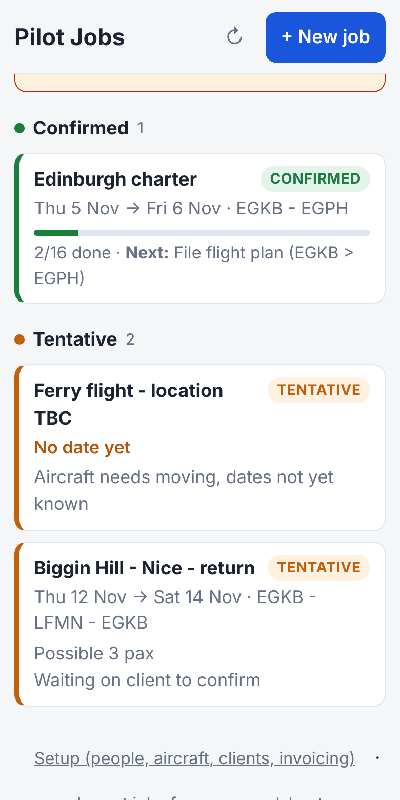
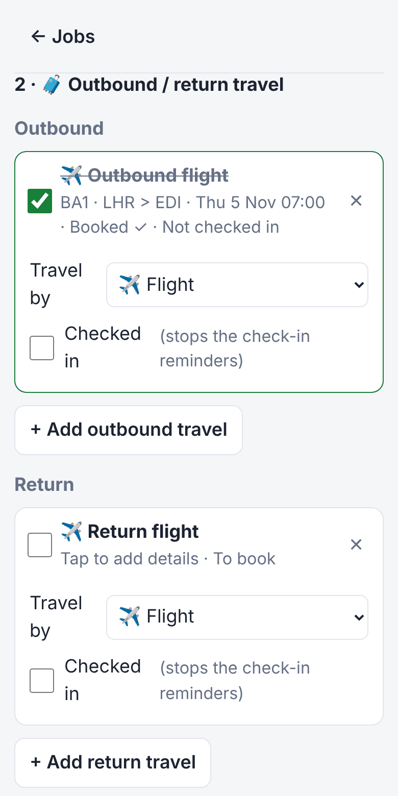
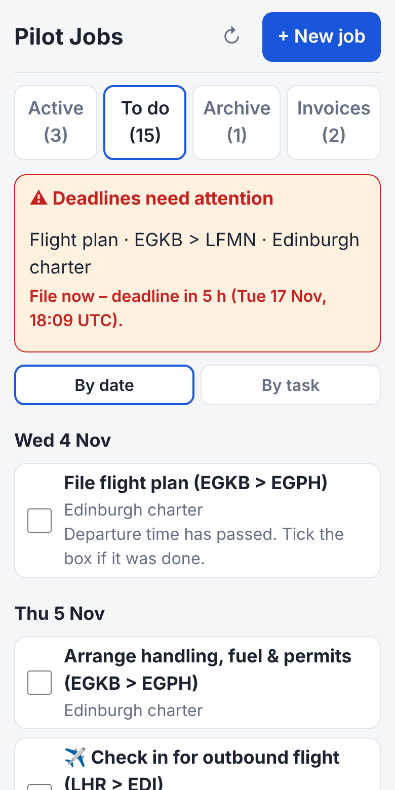
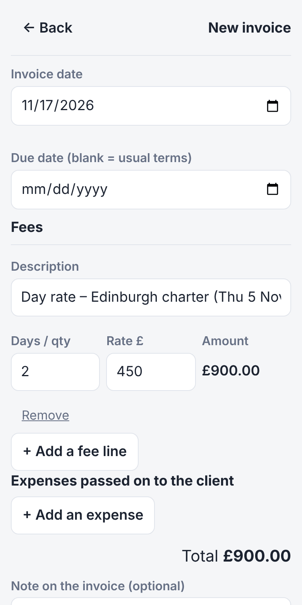

# Pilot Jobs

A simple job tracker and checklist for a freelance general aviation pilot, for use on a phone or laptop. This repository holds the web page. The data lives in the pilot's own Google account.

<p align="center">
  
  
  
  
</p>

<sub>Screenshots use invented sample data.</sub>

## Features

**Jobs and calendar**
- **Tentative and confirmed jobs:** tentative jobs show orange in Google Calendar and confirmed jobs show green. Cancelled jobs are archived and can be restored, or duplicated as a template for a repeat job.
- **Date clash warnings:** if a job's dates overlap another active job, the app warns but never blocks. Two confirmed jobs overlapping get a firm warning. Anything involving a tentative job gets a gentle heads-up, since holding two tentative dates is normal. Jobs without times count as all day, and a drive that starts the evening before counts as part of the job.
- **Import:** jobs can be added in bulk from a spreadsheet using the included template.

**Checklist for each confirmed job**
- **Legs:** GAR, flight plan and handling for each leg, with the From and To airports (ICAO codes) used to work out the GAR country.
- **Travel:** outbound and return by ✈️ flight, 🚆 train, 🚗 driving or other. Driving time is blocked out on the calendar, and commercial flights get a 24-hour check-in reminder.
- **Accommodation and post-flight tasks:** 🏨 stays, then 🧾 invoice and 💷 expense tasks, including a check that each has been paid.
- **To do tab:** everything outstanding across all jobs, sorted by date or by task.

**Deadlines and reminders**
- **GAR and flight plan deadlines:** calculated from the UK and French rules and added to the calendar, with popup reminders to the pilot's phone.

**GAR paperwork**
- **People and aircraft:** saved once, with regular passengers listed first for each aircraft.
- **Bulk-add people:** from the people list downloaded from the UK GAR service. Anyone already saved is topped up, not overwritten.
- **GAR file:** the Home Office GAR spreadsheet is filled in from the saved details.

**Invoicing**
- **Per-client day rates:** invoices are built from the job days, plus fees and expenses passed on to the client.
- **PDFs, no accidental sending:** each invoice is a PDF emailed to the pilot to check and forward, so nothing reaches a client without your seeing it.
- **Overdue payments:** a chase item and a ready-written reminder, firmer the later the payment.

**Everyday use**
- **Phone or laptop:** installable on a home screen, with large type. Use it on your laptop for entering details or looking at things on a larger screen, and have it in your pocket and ready to go on your phone.

## How it fits together

```
index.html (this repo, on GitHub Pages)  <-->  Google Apps Script (the pilot's own copy)  -->  Calendar, Gmail, Sheets
```

This page has no data and no secrets in it. On first use each device asks for the pilot's own server address and passcode, which are stored only in that browser.

## Files

| File | Purpose |
|---|---|
| `index.html` | The app (a single file) |
| `docs/` | The screenshots shown above |
| `manifest.webmanifest`, `icon-*.png`, `apple-touch-icon.png`, `favicon.svg` | Home-screen icon and name |
| `GAR_Template.xlsx` | The GAR form that is filled in |
| `pilot-jobs-import-template.xlsx` | Template for importing jobs from a spreadsheet |

The backend code (`Code.gs`) and the full setup guide are kept separately and are not needed to host this page.

## Hosting

1. Keep all the files above in the root of the repository.
2. Go to **Settings → Pages**, set the source to the `main` branch and `/ (root)`, and save.
3. Open the address GitHub gives you, then enter the server address and passcode.

To update, upload the new `index.html` over the old one, wait a minute, then refresh. On a phone, close and reopen the page if it still looks old.

## Privacy

Job, passenger and invoice data is stored in the pilot's own Google account, never in this repository. Do not commit personal data, server addresses or passcodes here.
